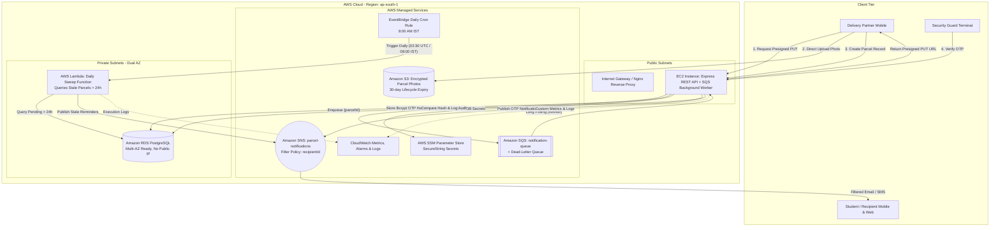
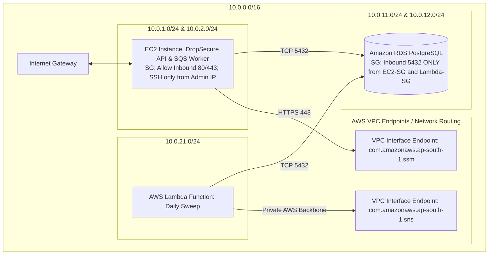
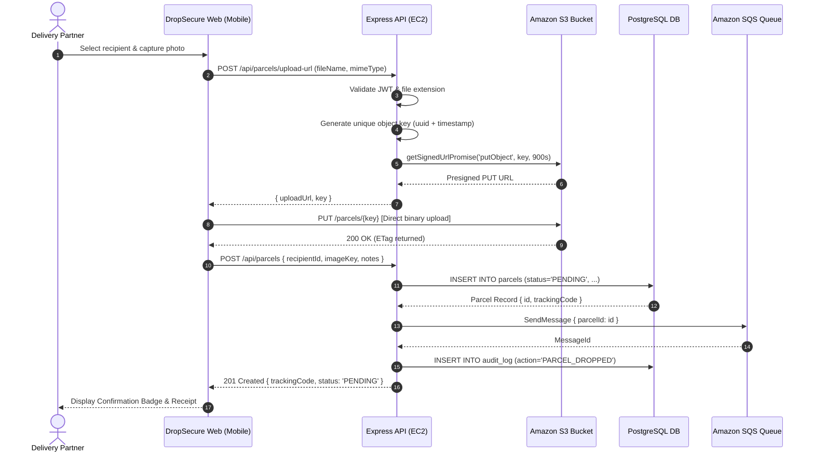
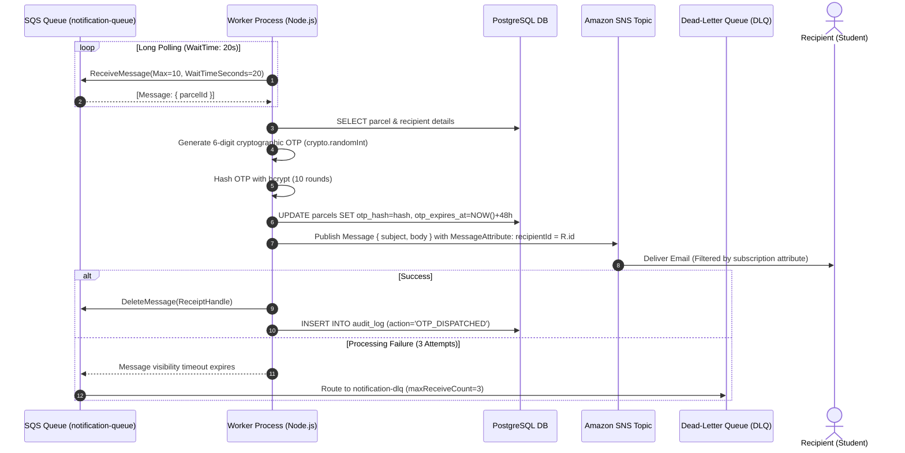
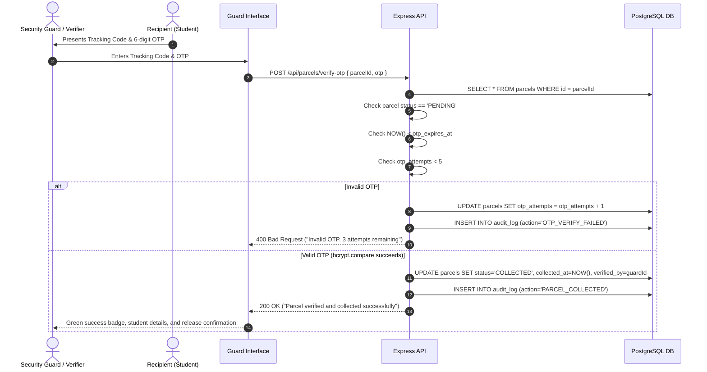
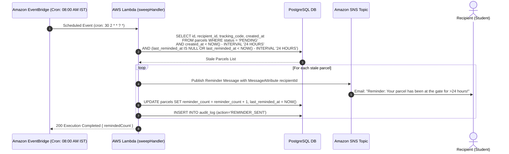

# DropSecure Architecture & Technical Blueprint

DropSecure is a cloud-native, zero-trust parcel handover and verification system engineered for high accountability, security, and low operational cost on Amazon Web Services (AWS).

---

## 1. High-Level AWS Architecture

---

## 2. VPC Network Topology & Security Boundaries

---

## 3. Detailed Sequence Diagrams

### Flow 1: Drop-off & Direct S3 Photo Upload

### Flow 2: Worker Notification & OTP Generation

### Flow 3: Gate Collection & OTP Verification

### Flow 4: Daily Sweep via EventBridge & Lambda (>24h Stale Parcels)

